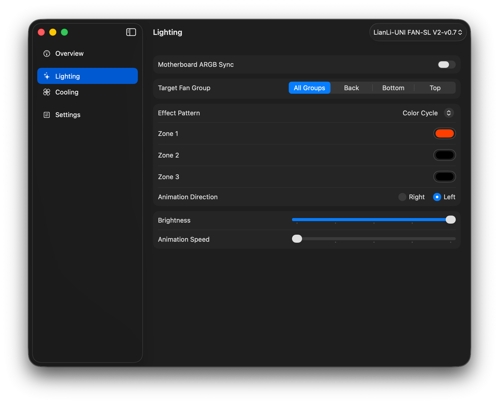
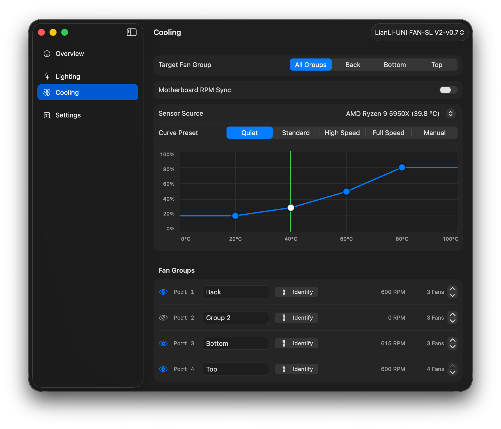

# F-Connect for macOS

An unofficial macOS app for controlling **Lian Li UNI FAN** hubs: fan speed, motherboard sync and lighting.

<table>
  <tr>
    <td width="50%"></td>
    <td width="50%"></td>
  </tr>
</table>

## Features

- **Cooling:** per-group fan curves driven by a CPU or GPU temperature,
  or hand a group to the motherboard (RPM sync) individually.
- **Lighting:** effects, per-zone colors, brightness, animation speed and direction; motherboard ARGB sync.
- Live RPM per group, group names, per-port fan count, Identify.
- Menu bar item with live RPM and whether each group follows the motherboard or a curve.

## Supported hardware

| Hub | Status |
|---|---|
| UNI FAN SL V2 | ✅ Verified on hardware |
| UNI FAN SL | ⚠️ Implemented, untested |
| UNI FAN AL | ⚠️ Implemented, untested |
| UNI FAN SL-Infinity | ⚠️ Implemented, untested |
| UNI FAN AL V2 | ⚠️ Implemented, untested |
| Strimer, Galahad, TL (fans / LCD) | ❌ Detected, not controlled |

## Temperature sources

| Platform | Source | Status |
|---|---|---|
| AMD Ryzen | `AMDRyzenCPUPowerManagement` kext (the one AMD Power Gadget uses) | ✅ Verified (Ryzen 9 5950X) |
| Intel | SMC CPU keys (`TC0D`, `TC0P`, `TCXC`, ...) | ⚠️ Implemented, untested |
| GPU | `IOAccelerator` statistics | ✅ Verified (RX 6800 XT) |

## Install

Download the latest `.dmg` from Releases, open it and drag F-Connect to Applications.

The app is signed ad-hoc and is not notarized, so macOS shows a warning on first launch. Clear the quarantine flag:

```bash
/usr/bin/xattr -dr com.apple.quarantine /Applications/F-Connect.app
```

Then open the app normally.

## Build from source

Requires Xcode.

```bash
make install
```

## Reporting a problem

Open an issue and attach the output of **Settings > Copy Diagnostics**.

## Disclaimer

Not affiliated with or endorsed by Lian Li. Use at your own risk; fan control software can affect cooling.
